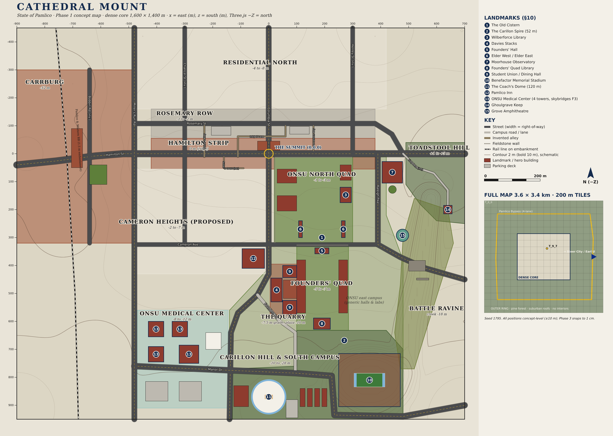

# Cathedral Mount: Phase 1 concept map

- Map (vector): `docs/phase-1/concept-map.svg`
- Map (raster): `screenshots/phase-1/concept-map.png`
- Machine-readable layout: `docs/phase-1/concept-layout.json`. Phases 2 and 3 seed from it.
- Generator: `tools/concept-map/layout.mjs`, rendered by `render.mjs` and rasterized by `shoot.mjs`.

All positions are concept-level, accurate to about ±10 m. Phase 3 snaps roads and lots to the 1 cm grid.

**Coordinates.** Plan coordinates are `[x, z]` in meters.

- +x is east.
- +z is south, so Three.js −Z is north.
- The origin is The Summit at street crown.

**Map size and tiles.**

- Dense core: x −900…+700, z −450…+950, which is 1,600 × 1,400 m.
- Full map: x −1,900…+1,700, z −1,450…+1,950, which is 3.6 × 3.4 km.
- The full map holds 18 × 17 tiles of 200 m.
- The origin falls in **T_9_7**, which spans x −100…+100 and z −50…+150. The Summit sits near the middle of its tile, not on a tile seam.

---

## 1. Districts

| District | Extent (x, z) | Elevation | Character |
|---|---|---|---|
| **Hamilton Strip** | x −420…+380, z −55…+55 | 0 m (ridge crown) | Right-of-way 22.5 m: 2 × 330 cm lanes, 2 × 244 cm parking, sidewalks of about 5.5 m. North side has continuous 2–4 story fronts. South side has fronts at x −420…0 and x +300…+380. |
| **The Summit** | r ≈ 40 m around the origin | 0 m | Top of the Mount sits on the NE corner. Bluebird Savings Bank sits on the NW corner. Scramble crosswalk. |
| **Rosemary Row** | x −420…+380, z −160…−55 | −1 to −2 m | Rosemary St centerline at z −108. Two 5-level decks at x −205…−135 and x +75…+145. Rear service zone. Apartment blocks over shops on the north side. |
| **Residential North** | x −480…+420, z −450…−160 | −4 → −8 m | Gridded 1–2 story houses with full interiors. |
| **ONSU North Quad** | x 20…300, z 11…325 | −1 → −3 m | Lawn on axis x 190, about 120 × 300 m. Fieldstone wall on Hamilton St and Columbia St. 30–40 willow oaks. Old Cistern at the south end, flanked by Elder West and Elder East. Wilberforce Library and 3 historic halls on the sides. |
| **Founders' Quad** | x 100…285, z 325…632 | −5 → −7 m | Lawn 110 × 220 m on axis x 190. Founders' Hall at the north end (z 337) and the domed library at the south end (z 588). Three halls on each side. |
| **The Quarry** | x 5…100, z 395…580 | Grade −7.5 m, plaza −10 m | Plaza about 48 × 66 m, sunk 2.5 m below grade. Dining Hall to the north, Student Union to the south, Davies Stacks on the west edge. Sits beside the SW corner of Founders' Quad. |
| **Carillon Hill & South Campus** | x −130…480, z 632…950 | −10 → −28 m | Spire at (270, 668) on a terraced lawn. Stadium bowl floor −28 m at (360, 810). Coach's Dome at (0, 870). 4 residence towers, rec center and a deck. |
| **ONSU Medical Center** | x −470…−145, z 560…910 | −8 to −12 m | 4 towers with skybridges at F3. Tower D is the tallest and carries the helipad. ER bay faces Columbia St. 2 decks south of Manor Dr. |
| **Carrburg** | x −900…−480, z −300…+320 | −12 m | Rail line on an embankment at x ≈ −722. Loomhouse Mill (140 m, north–south, sawtooth roof) beside the tracks. Town commons. Painted one-story fronts on Hamilton St. |
| **Toadstool Hill** | x 490…700, z −40…+250 | +1 to +3 m | Keep Lane winds to Ghoulgrave Keep on the ravine rim. Pines and holly. Lanterns only. |
| **Battle Ravine** | x 450…660, z 160…770 | Creek bed −18 m | Steep wooded RED_CLAY banks. Stone footbridge at z 450. Grove Amphitheatre on the west slope. Raleigh Pike crosses it on a viaduct. |
| *Cameron Heights (proposed)* | x −480…−10, z 55…430 | −2 to −7 m | Fills a gap in the spec (see Ambiguity 3). Historic houses and churches around the Pamlico Inn. |
| *ONSU east campus (filler)* | x 280…480, z 110…630 | −3 to −10 m | Procedural academic and lab halls between the quads and the ravine. |
| **Outer ring** | 1 km band | — | Pine forest, the 4-lane Pamlico Bypass loop about 600 m outside the core, suburban roof impostors, and the Steer City / Earl University skyline impostor to the east. No interiors. |

## 2. Streets

| Street | Route | Right-of-way |
|---|---|---|
| Hamilton St | E–W at z 0 from x −520 to +700. Bends slightly north-west through Carrburg and descends 12 m between x −480 and x −700. | 22.5 m |
| Columbia St | N–S at x 0 from z −450 to +430, then curves SW along the east edge of the Medical Center to z 950. Climbs 6 m from Cameron Ave (−6 m) to The Summit. | 18 m |
| Rosemary St | E–W at z −108. Joins Hamilton St at x +480. | 16 m |
| Cameron Ave | E–W at z 325. Separates North Quad from Founders' Quad and passes the Old Cistern and Founders' Hall. | 14 m |
| Raleigh Pike | South from Hamilton St at x 390, then ESE over Battle Ravine on a viaduct toward the bypass. | 18 m |
| Founders Rd | Campus service road from Columbia St past the Quarry, then south to Manor Dr. | 10 m |
| Manor Dr | E–W at z ≈ 775–940. Hospital → Coach's Dome → west of the stadium → east toward the bypass. | 20 m |
| Miller's Run Rd | N–S at x −480. Boundary between Carrburg and Chapel-side blocks. | 18 m |
| Chancel St *(inv.)*, Henley St *(inv.)*, Bobbin Rd *(inv.)*, Keep Lane *(inv.)* | Cross streets and Toadstool lane. | 6–14 m |
| **Tanner's Alley** | x −230, Hamilton → Rosemary | 5 m |
| **Inkwell Lane** | x −110, then an L-turn to the east deck | 4.5 m |
| **Blue Lantern Way** | x +160, Hamilton → Rosemary | 4 m |
| Sutter's Court *(inv., 4th alley)* | South-side dog-leg behind Sutter's | 3.5 m |

## 3. Elevation story

The full set of spot elevations is in `concept-layout.json`.

- **Hamilton Ridge:** 0 m across the whole strip.
- **North of the ridge:** falls to −8 m at z −420.
- **Campus:** steps down southward:
  - North Quad −2 m
  - Columbia St × Cameron Ave −6 m
  - Founders' Quad −6 m
  - Quarry plaza −10 m
  - Carillon −10 m
  - Stadium bowl floor −28 m
- **Battle Ravine:** cuts to −18 m and runs toward the stadium's east rim.
- **Carrburg:** sits on a −12 m plain. The 12 m drop happens on Hamilton St between Miller's Run Rd and the tracks, at about 4.3%.
- **Toadstool Hill:** rises gently to about +3 m, so the Keep reads against the sky above the ravine.

The heightfield in `layout.mjs` is schematic: inverse-distance weighting of spot heights, plus carved ravine and bowl profiles. Phase 3 replaces it with the authored 0.5 m field.

## 4. Landmark placement

| # | Landmark | Position / footprint (m) | Tile |
|---|---|---|---|
| 1 | The Old Cistern | center (190, 300), platform r 6 | T_10_8 |
| 2 | The Carillon Spire | 10 × 10 at (270, 668) | T_10_10 |
| 3 | Wilberforce Library | x 255–295, z 120–175 (east side of North Quad) | T_10_7 |
| 4 | Davies Stacks | x 8–48, z 445–530 | T_9_9 |
| 5 | Founders' Hall | x 165–215, z 337–358 | T_10_8 |
| 6 | Elder West / Elder East | 13 × 60 slabs flanking the Cistern | T_10_8 |
| 7 | Moorhouse Observatory | x 405–478, z 28–105. Sundial garden at (442, 128). | T_11_7 |
| 8 | Founders' Quad Library | x 160–220, z 588–628 | T_10_10 |
| 9 | Student Union / Dining Hall | x 50–100, south and north of the Quarry plaza | T_9_10 / T_9_9 |
| 10 | Benefactor Memorial Stadium | x 250–470, z 715–905. Field E–W, centered (360, 810). | T_11_11 |
| 11 | The Coach's Dome | r 60 at (0, 870) | T_9_11 |
| 12 | Pamlico Inn | x −95 to −15, z 340–410 (SW corner of Columbia × Cameron) | T_9_9 |
| 13 | Medical Center towers A–D | x −430 to −250, z 600–750 | T_7_10 / T_8_10 |
| 14 | Ghoulgrave Keep | x 625–655, z 185–215 | T_12_8 |
| 15 | Grove Amphitheatre | bowl r 22 at (478, 292), west slope of the ravine | T_11_8 |

## 5. Compressions relative to real Chapel Hill (about 0.6×, more where noted)

| Real relationship | Real (approx.) | Cathedral Mount | Factor |
|---|---|---|---|
| Downtown Franklin St (Merritt Mill Rd → Raleigh St) | ~1.3 km | Hamilton Strip 800 m | 0.62 |
| McCorkle Place frontage on Franklin St | ~450 m incl. flanking buildings | North Quad 280 m | 0.62 |
| Polk Place lawn | ~180 × 360 m | 110 × 220 m (as spec) | 0.61 |
| Old Well → Bell Tower | ~600 m | Cistern → Spire ≈ 375 m | 0.62 |
| Franklin × Columbia → UNC Hospitals main entrance | ~1.1 km | Summit → ER ≈ 680 m | 0.62 |
| Franklin × Columbia → Dean Dome | ~2.0 km | Summit → Coach's Dome 870 m | **0.43**, so the arena stays walkable |
| South Campus high-rise dorms → Old Well | ~1.5 km | ≈ 590 m | **0.40**, pulled next to the dome and stadium |
| Columbia St → Carrboro Weaver St area | ~1.7 km | Summit → Loomhouse Mill ≈ 700 m | **0.41** |
| Old Well → Gimghoul Castle | ~1.0 km | Cistern → Ghoulgrave Keep ≈ 490 m | 0.49 |
| Franklin St → Rosemary St block depth | ~100 m | 108 m | 1.0 (human-scale block kept) |
| Kenan Stadium bowl relief | ~25–30 m | 28 m | 1.0 (spec value) |

## 6. Merges and remixes

- **Morehead Planetarium and its sundial garden → Moorhouse Observatory.** The sundial garden fronts Hamilton St just past the east end of the strip.
- **The Pit, Student Union, Student Stores, Lenoir and Davis → The Quarry.** A single compact cluster beside Founders' Quad's SW corner.
- **Wilson Library → Founders' Quad Library.** **Original library hall and Carnegie-era library feel → Wilberforce Library.**
- **Carolina Inn → Pamlico Inn.** It keeps its real relationship to the main north–south street and the street that runs east into campus (SW corner).
- **Battle Park and Forest Theatre → Battle Ravine and Grove Amphitheatre.** The ravine now drains toward the stadium, which ties the east woods to the bowl.
- **Gimghoul neighborhood and castle → Toadstool Hill and Ghoulgrave Keep.** The Keep sits on the ravine rim.
- **UNC Hospitals' sprawl → 4 towers, an ER and 2 decks.** The towers are joined by F3 skybridges.
- **Carr Mill → Loomhouse Mill co-op.** The mill sits beside the tracks, which are lifted onto a 1.5 m embankment.
- **The many south-campus dorms → 4 towers** in a row between the dome and the stadium.

## 7. Inventions (not in the real town)

- **Cameron Heights:** a district of houses, churches and the Inn. It fills the spec gap west of Columbia St and south of Hamilton St.
- **ONSU east campus filler:** procedural halls between the quads and the ravine.
- **Raleigh Pike viaduct:** a stone-faced arch bridge over Battle Ravine, with the stone footbridge below it at creek level.
- **Streets:**
  - Founders Rd, as a campus service loop
  - Chancel St, Henley St, Bobbin Rd and Keep Lane
  - Sutter's Court, a 4th alley
  - Inkwell Lane's dog-leg into the east Rosemary deck
- **The 12 m Carrburg descent:** Hamilton St drops from the ridge to the mill plain. This gives the west end a downhill vista toward the mill smokestack.
- **Pamlico & Western RR:** the rail line through Carrburg.
- **Pamlico Bypass:** a 4-lane loop in the outer ring.
- **Toadstool Hill's +3 m knoll:** the only ground above the ridge.

---

## 8. Ambiguities and proposed defaults

These are also listed in the chat report. Each one has a default I'll use unless you say otherwise.

1. **Repo layout.** The spec tree is rooted at `/cathedral-mount`, but the repo is `JungleHop`. *Default: project at the repo root.*
2. **Two domed classical libraries.** Wilberforce (#3, North Quad) and the Founders' Quad library (#8) risk reading as twins, and #8 has no name. *Default:*
   - Wilberforce is a low Carnegie-style temple front with a saucer dome.
   - #8 is taller, with a drum dome, and is named **"Ashgrove Library"**.
3. **Unassigned land needs buildings with interiors.** No district covers west of Columbia St / south of Hamilton St, or east campus. *Default: Cameron Heights plus east-campus filler, both procedural.*
4. **Building count.** Full interiors everywhere means roughly **600–750 enterable buildings**. Residential North alone is about 280 houses. *Default:*
   - All generated deterministically from the seed.
   - `rooms.json` written per tile (`data/rooms/T_c_r.json`) plus an index, instead of one huge file.
5. **Door "clear" size.** A 91 cm leaf gives about 86 cm clear opening. *Default: treat 91 × 213 cm as the nominal leaf size and test the leaf. Clear width ≥ 81 cm is logged.*
6. **Hamilton St name in Carrburg.** In reality Franklin St becomes Main St. *Default: keep Hamilton St through Carrburg* (unless you want "Mill St" west of Miller's Run Rd).
7. **"Pitch Soles" is used twice:** as the ONSU nickname and as the tattoo shop name. *Default: intentional, kept.*
8. **Sun azimuth convention.** *Default: compass degrees clockwise from north, so 250° is WSW. That gives low sun raking east down Hamilton St at golden hour.*
9. **Toadstool Hill elevation** is unspecified. *Default: +1 to +3 m.*
10. **South-side storefronts east of the quad.** They are only about 80 m long (x 300–380) before Raleigh Pike and Moorhouse. *Default: accept.*
11. **Trademark blacklist** for the parody test. *Default: I author one in `tests/data/trademarks.txt`, covering national chains and well-known real Chapel Hill and Carrboro businesses.* This is also why the mill is "Loomhouse", not a Weaver-anything.
12. **Network and fonts.** *Default: fonts come from `@fontsource/*` npm packages copied into `/public/fonts`, with Three.js pinned at scaffold time.* No extra installs beyond npm packages.
13. **Brick geometry budget.** One 3-story facade is about 40k bricks. *Default: instanced per-brick geometry only inside the 15 m ring, swapped by tile-local chunks. Beyond that, normal-mapped panels, per §17.*

## 9. Known issues in this Phase 1 deliverable

- The heightfield is schematic (inverse-distance weighting), and the contours are illustrative.
- Building footprints show only landmarks and key features. Lot subdivision happens in Phases 3, 7 and 8.
- The concept map uses hex values copied from §4 in `tools/`, which is outside `/src`. Runtime code will import `palette.ts` only.
